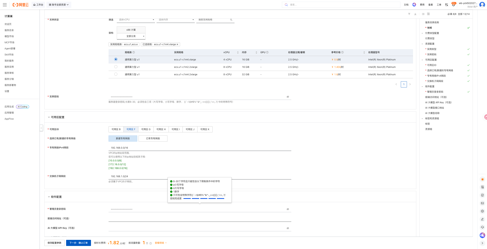
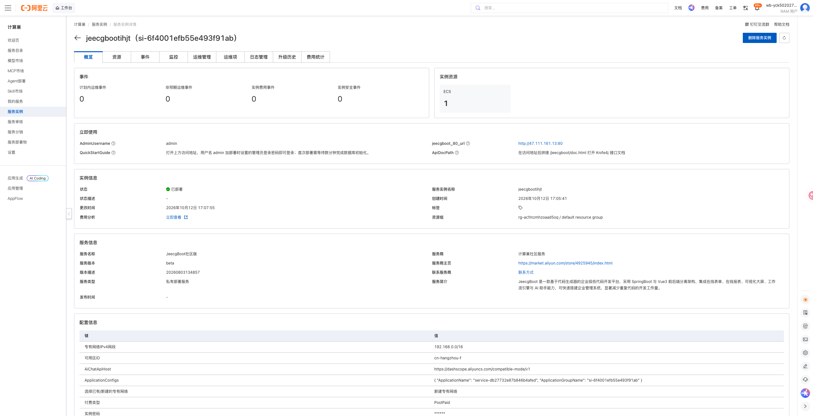
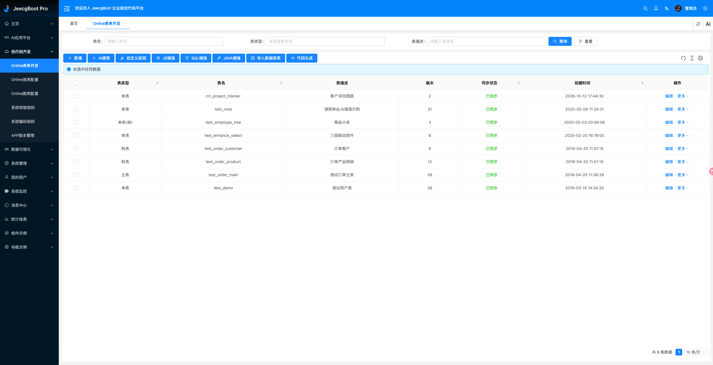

# JeecgBoot 计算巢部署文档

## 概述

JeecgBoot 是一款基于 Spring Boot 和 Vue 3 的开源低代码开发平台，提供 Online 表单、代码生成、流程、报表、权限管理和 AI 应用等能力。本方案将 JeecgBoot 前后端、MySQL、Redis 和 pgvector 以 Docker 容器部署到用户自己的阿里云 ECS 中。

| 项目 | 说明 |
| --- | --- |
| 服务 ID | `service-db27732e87b846b4afed` |
| 部署形态 | 单台 ECS + Docker |
| 访问端口 | 80（HTTP） |
| 管理员用户名 | `admin` |
| API 文档 | `/jeecgboot/doc.html` |
| 实测部署耗时 | 约 134 秒 |

## 部署架构

```text
浏览器
  │ HTTP 80
  ▼
安全组
  ▼
ECS
  └─ Docker
      ├─ Nginx / JeecgBoot Vue 3 前端
      ├─ JeecgBoot System 后端
      ├─ MySQL
      ├─ Redis
      └─ pgvector
```

计算巢通过 ROS 创建 VPC、交换机、安全组和 ECS，并在 ECS 上启动应用及数据库容器。所有业务组件均位于同一台 ECS 中，不会额外创建 RDS、Redis 等托管数据库资源。

## 部署前准备

### 账号与权限

请使用已完成实名认证的阿里云账号，并确保账号可创建以下资源：

- 资源编排 ROS 资源栈；
- ECS 实例、系统盘与安全组；
- VPC 和交换机；
- 计算巢服务实例。

使用 RAM 用户部署时，应由管理员授予上述资源的创建、查询和删除权限。

### 计费说明

部署会创建一台 ECS，并可能产生公网流量费用。费用以创建页实时询价和阿里云账单为准。测试场景建议选择按量付费，并在验证结束后及时删除服务实例。

## 部署步骤

### 1. 打开创建页面

访问 [JeecgBoot 服务实例创建页](https://computenest.console.aliyun.com/service/instance/create/cn-hangzhou?type=user&ServiceId=service-db27732e87b846b4afed)。



### 2. 配置部署参数

| 参数 | 说明 | 建议 |
| --- | --- | --- |
| 服务实例名称 | 控制台中用于识别本次部署 | 保持默认或自定义 |
| 地域与可用区 | ECS 所在位置 | 选择接近使用者且有库存的可用区 |
| 付费类型 | 按量付费或包年包月 | 测试使用按量付费 |
| 实例类型 | ECS 规格 | 最低可选 4 vCPU / 16 GiB |
| 实例密码 | ECS 登录密码 | 使用符合页面规则的强密码 |
| 管理员登录密码 | `admin` 账号首次登录密码 | 使用不同于 ECS 密码的强密码 |
| 前端访问地址 | 自定义域名或 URL | 可留空，自动使用实例公网 IP |
| AI 大模型 API Key | 启用 AI 助手时使用 | 可留空；不要填写到非可信环境 |
| AI 接口地址 | OpenAI 兼容接口 | 默认使用阿里云百炼兼容地址 |
| AI 模型名称 | AI 助手调用的模型 | 默认 `qwen-plus` |
| 专有网络 | 新建或复用 VPC | 首次部署可选择新建 |

填写完成并看到询价结果后，点击“下一步：确认订单”，核对资源和费用，勾选服务协议并创建实例。

### 3. 等待部署完成

进入服务实例详情页，等待状态变为“已部署”。本次实测从创建到部署完成约 134 秒。



“立即使用”区域会显示：

- `jeecgboot_80_url`：JeecgBoot 访问地址；
- `QuickStartGuide`：首次登录说明；
- `AdminUsername`：管理员用户名；
- `ApiDocPath`：Knife4j 接口文档路径。

## 首次访问与使用

打开 `jeecgboot_80_url`，使用用户名 `admin` 和部署时设置的管理员登录密码登录。首次访问时如数据库仍在初始化，请等待数分钟后重试。

登录后可进入“低代码开发 → Online 表单开发”创建业务表。发布前实测创建了包含项目名称和项目状态字段的表单，并执行普通同步；刷新页面后表单仍存在且状态保持“已同步”。



Knife4j 接口文档位于访问地址后的 `/jeecgboot/doc.html`。

## 可用性验证

| 验证项 | 结果 |
| --- | --- |
| 服务实例 | 状态为“已部署” |
| 应用访问 | 登录页和管理后台正常加载 |
| 身份认证 | 使用部署时设置的管理员密码成功登录 |
| Online 表单 | 成功创建 `cn_project_tracker` 表单 |
| 数据库同步 | 普通同步成功，状态变为“已同步” |
| 数据持久化 | 刷新页面后表单和同步状态仍存在 |

## 数据与安全

- JeecgBoot、MySQL、Redis 和 pgvector 均运行在用户自己的 ECS 中。
- 部署参数文件位于 `/opt/jeecgboot/params`，密码和 API Key 文件具有受限权限；不要复制、上传或提交这些文件。
- 默认通过公网 HTTP 80 端口访问。生产环境建议限制安全组来源，并为自定义域名配置 HTTPS。
- AI API Key 为可选项；不使用 AI 助手时保持为空。
- 删除服务实例会同时删除 ECS 及其本地数据，释放前请先完成数据库和附件备份。

## 资源释放

不再使用时，在计算巢服务实例详情页执行“删除”。删除完成后建议继续确认：

1. 服务实例已不存在；
2. ROS 资源栈状态为 `DELETE_COMPLETE`；
3. ECS、VPC、交换机和安全组均无残留；
4. 账单中不再产生相关按量资源费用。

## 官方链接

- [JeecgBoot 官方仓库](https://github.com/jeecgboot/JeecgBoot)
- [JeecgBoot 官方文档](https://help.jeecg.com/)
- [JeecgBoot Docker 文档](https://help.jeecg.com/java/setup/docker/)
- [阿里云计算巢文档](https://help.aliyun.com/zh/compute-nest/)
